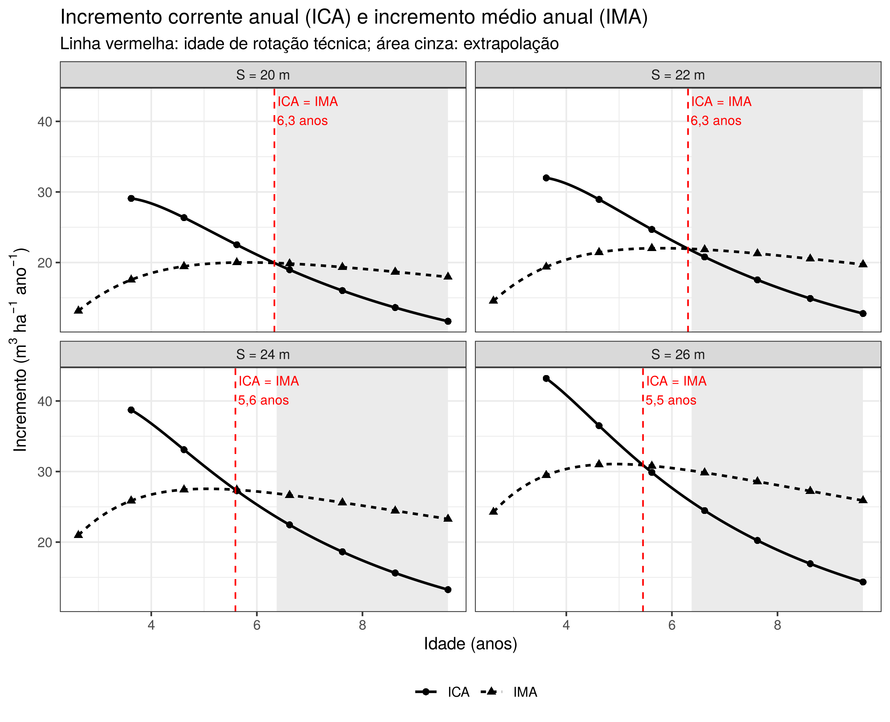
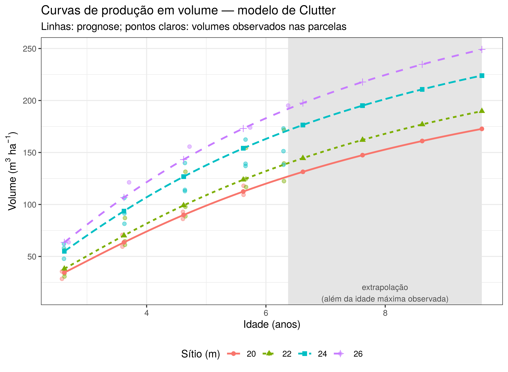

<div align="center">

# 🌲 Desafio 09 — Crescimento e produção (Clutter)

**Prognose de área basal e volume e idade técnica de corte**

   

*Disciplina Mensuração Florestal · Programa de Pós-Graduação em Ciências Florestais · ICA/UFMG*

</div>

## 📋 Objetivo

Ajustar o sistema de equações compatíveis de Clutter (1963), gerar a prognose de área basal e volume para diferentes índices de sítio e identificar a idade técnica de corte (ICA = IMA).

## 🗂️ Dados

Projeto C531: 9 parcelas permanentes e 43 medições entre 2,6 e 6,4 anos. Entrada principal: [`dados/base_consolidada_sitio.csv`](dados/base_consolidada_sitio.csv), gerada no [Desafio 08](https://github.com/danieldias936-cyber/Desafio-08-Validacao-do-Sitio).

## 🔧 Métodos

- **Eq. 1** (área basal futura) e **Eq. 2** (volume) do sistema de Clutter, ajustadas por regressão.
- **Eq. 3**: volume futuro compatível, validado com pares de medições.
- Prognose para S = 20, 22, 24 e 26 m e idade técnica de corte no cruzamento de ICA e IMA.

## 📈 Principais resultados

| Equação | R² | Syx (%) |
|---|:-:|:-:|
| Eq. 1 — área basal | 0,968 | 3,59 |
| Eq. 2 — volume | 0,987 | 4,97 |
| Eq. 3 — validação | 0,954 | 6,85 |

| Sítio (m) | Idade técnica de corte (anos) | Volume (m³/ha) | IMA (m³/ha/ano) |
|:-:|:-:|:-:|:-:|
| 20 | 6,3 | 126,3 | 19,9 |
| 22 | 6,3 | 138,4 | 22,0 |
| 24 | 5,6 | 153,4 | 27,4 |
| 26 | 5,5 | 168,5 | 30,9 |

- Quanto melhor o sítio, maior a produção e mais cedo o IMA atinge o máximo.

<p align="center">
  <br>
  <sub><b>ICA e IMA por índice de sítio e idade técnica de corte</b></sub>
</p>

<p align="center">
  <br>
  <sub><b>Curvas de produção em volume por sítio</b></sub>
</p>

## 📁 Estrutura do repositório

```text
Desafio-09-Crescimento-e-Producao/
├── dados/
│   ├── base_consolidada_sitio.csv     # saída do Desafio 08
│   └── Dados_Clutter_original.xlsx    # usada só se o CSV não existir
├── scripts/
│   └── 01_modelo_clutter.R
├── resultados/
│   ├── tabelas/          # equações, métricas, prognose, idade de rotação
│   ├── figuras/
│   └── log_execucao.txt
└── docs/
    ├── relatorio.md
    └── metodologia_detalhada.md
```

## ▶️ Como executar

A partir da raiz do repositório:

```r
install.packages(c("readxl", "ggplot2"))
```

```bash
LC_ALL=C.UTF-8 Rscript scripts/01_modelo_clutter.R
```

## 📄 Documentos

- 📊 [Relatório](docs/relatorio.md)
- 🔍 [Metodologia detalhada](docs/metodologia_detalhada.md)

## 🧭 Série de desafios

| # | Desafio | |
|:-:|---|:-:|
| 01 | [Diâmetro](https://github.com/danieldias936-cyber/Desafio-01-Diametro) | |
| 02 | [Altura e relação hipsométrica](https://github.com/danieldias936-cyber/Desafio-02-Altura) | |
| 03 | [Volume e forma](https://github.com/danieldias936-cyber/Desafio-03-Volume-e-Forma) | |
| 04 | [Volume reduzido e equações de volume](https://github.com/danieldias936-cyber/Desafio-04-Volume-Reduzido-e-Tabela) | |
| 05 | [Taper e sortimento](https://github.com/danieldias936-cyber/Desafio-05-Taper-e-Sortimento) | |
| 06 | [Amostragem de Bitterlich](https://github.com/danieldias936-cyber/Desafio-06-Bitterlich) | |
| 07 | [Classificação de sítios florestais](https://github.com/danieldias936-cyber/Desafio-07-Classificacao-de-Sitios) | |
| 08 | [Validação do índice de sítio](https://github.com/danieldias936-cyber/Desafio-08-Validacao-do-Sitio) | |
| **09** | **Crescimento e produção (Clutter)** | 📍 você está aqui |

## 👤 Autor

**Daniel Dias** · [@danieldias936-cyber](https://github.com/danieldias936-cyber)  
Mestrado em Ciências Florestais — ICA/UFMG, Montes Claros (MG)
