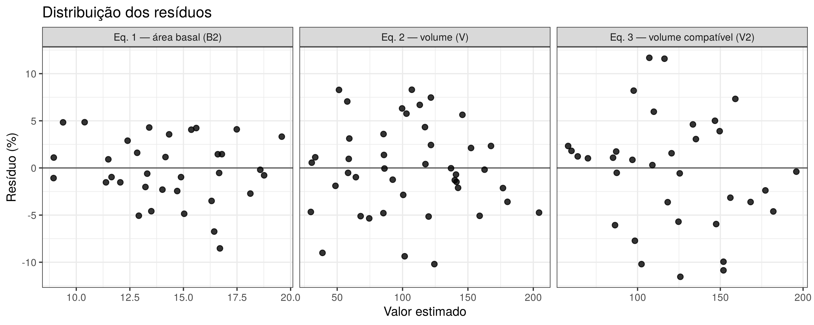
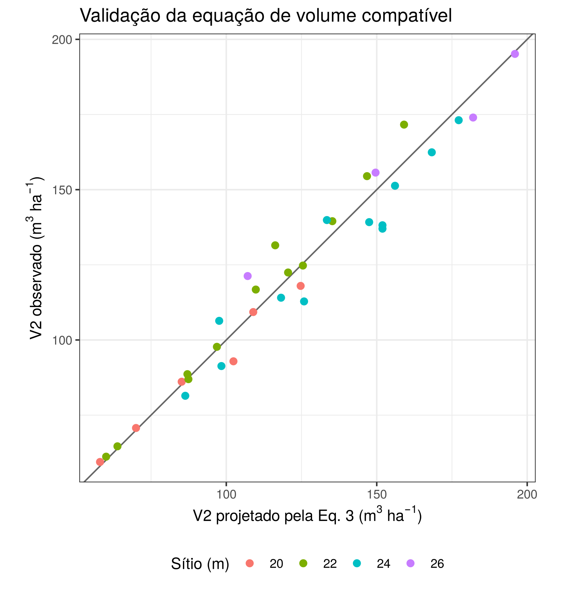
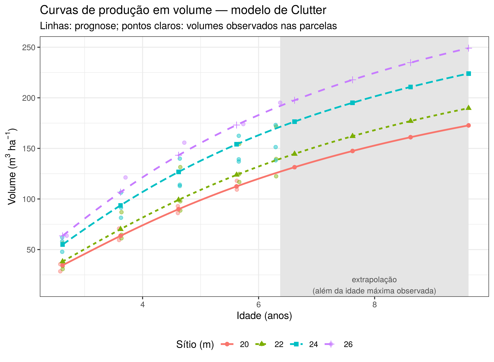
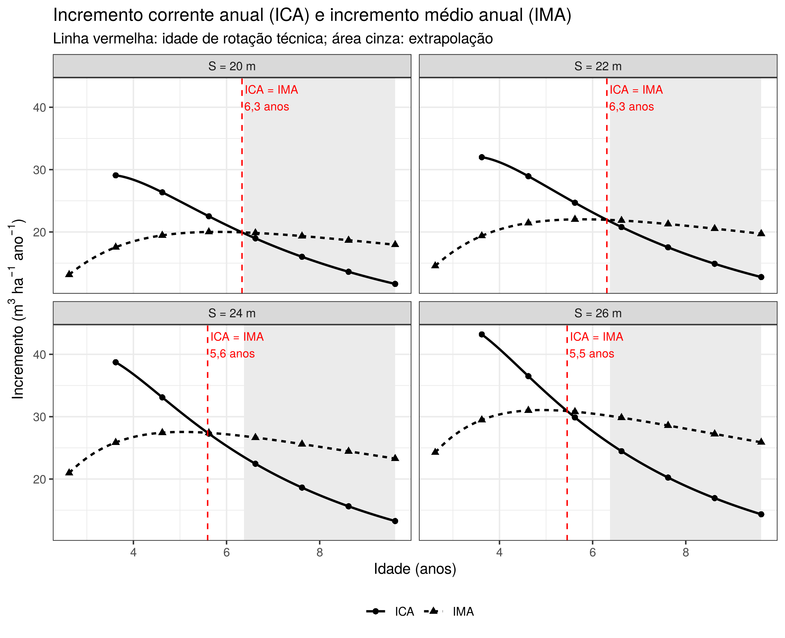

# Relatório — Desafio 09: crescimento e produção pelo modelo de Clutter

## 1. Dados e método

A base é a `base_consolidada_sitio.csv` do Desafio 08: 9 parcelas do projeto C531, com 43 medições entre 2,62 e 6,37 anos, área basal (B), volume (V) e o índice de local (S) fornecido. Os pares de medições sucessivas da mesma parcela somam 34.

- **Eq. 1 — área basal.** ln(B2) = (I1/I2)·ln(B1) + a0·(1 − I1/I2) + a1·(1 − I1/I2)·S. Ajustada por regressão linear sem intercepto sobre y = ln(B2) − (I1/I2)·ln(B1), com os 34 pares.
- **Eq. 2 — volume.** ln(V) = b0 + b1/I + b2·S + b3·ln(B). Ajustada com as 43 medições.
- **Eq. 3 — volume compatível.** Aplicação sequencial: B2 pela Eq. 1 e, em seguida, V2 pela Eq. 2 avaliada em I2. A forma analítica, ln(V2) = b0 + b1/I2 + b2·S + b3·[(I1/I2)·ln(B1) + a0·(1 − I1/I2) + a1·(1 − I1/I2)·S], produziu valores idênticos. Observação: a expressão da Eq. 3 que aparece no enunciado não corresponde exatamente a essa substituição; vale conferir a notação no Capítulo 11.
- **Prognose.** Idade inicial de 2,62 anos (média da primeira medição) e área basal inicial igual à média observada na primeira medição de cada sítio: 6,49, 6,85, 8,93 e 9,78 m²/ha para S = 20, 22, 24 e 26 m. Passo de 1 ano. ICA(I) = V(I) − V(I − 1) e IMA(I) = V(I)/I. A idade de rotação técnica é a raiz de ICA − IMA.

## 2. Equações ajustadas e qualidade do ajuste

| Equação | Parâmetro | Estimativa | Erro padrão | p |
|---|---|---|---|---|
| 1 | a0 | 2,81707 | 0,34585 | < 0,001 |
| 1 | a1 | 0,02365 | 0,01520 | 0,129 |
| 2 | b0 | 1,30501 | 0,17822 | < 0,001 |
| 2 | b1 | −1,13195 | 0,26407 | < 0,001 |
| 2 | b2 | 0,01602 | 0,00586 | 0,009 |
| 2 | b3 | 1,25513 | 0,07304 | < 0,001 |

| Equação | Escala | R² | Syx | Syx (%) | Viés médio |
|---|---|---|---|---|---|
| 1 — área basal | B2 (m²/ha) | 0,968 | 0,51 | 3,6 | −0,03 |
| 2 — volume | V (m³/ha) | 0,987 | 5,21 | 5,0 | −0,01 |
| 3 — volume compatível (validação) | V2 (m³/ha) | 0,954 | 8,23 | 6,8 | −0,45 |

As métricas foram calculadas na escala original, depois da retransformação logarítmica (sem fator de correção). Os resíduos ficaram entre cerca de −12% e +12%, sem tendência visível em relação aos valores estimados:

**Termo de sítio na Eq. 1.** O coeficiente a1 não foi significativo a 5% (p = 0,129). Ou seja, com estes dados não há evidência forte de que o sítio altere a trajetória de projeção da área basal, além do efeito que já entra pela área basal inicial. Como teste de sensibilidade, ajustou-se a forma reduzida, sem a1, que deu a0 = 3,35355. É exatamente o valor usado na planilha de referência `prognose_clutter.xlsx`. A planilha também ajusta a Eq. 2 com os 34 pares (em I2) e não com as 43 medições; refazendo esse ajuste, o script reproduz os coeficientes dela (1,498; −1,349; 0,0162; 1,197). A forma completa foi mantida porque é a pedida no enunciado. As idades de rotação com a forma reduzida estão na Seção 4.

## 3. Coerência da equação de volume compatível

Projetando V2 a partir de B1 nos 34 pares, o viés médio foi de −0,45 m³/ha, com RMSE de 6,2%. A projeção acompanha bem os volumes observados. Na parcela T6-P1, projetada a partir da primeira medição (2,69 anos), os desvios foram de −11,7% aos 3,7 anos, −8,0% aos 4,7, −0,6% aos 5,7 e −3,2% aos 6,4 anos.

Os maiores desvios médios por parcela aparecem em T3-P1 (+10,0%, superestimativa) e T2-P2 (−5,9%, subestimativa). São justamente as parcelas cujo S calculado no Desafio 08 mais diferiu do S fornecido: T3-P1 teve S calculado de 21,3 m, contra 24 fornecido, e T2-P2 teve 24,6 m, contra 22. Quando o S atribuído superestima o sítio real da parcela, o modelo superestima o volume, e vice-versa. Isso confirma, por outra via, a discussão do Desafio 08 sobre a atribuição do S por talhão.

## 4. Prognose de produção

| Idade (anos) | V S20 | V S22 | V S24 | V S26 | Diferença S26 − S20 | Razão S26/S20 |
|---|---|---|---|---|---|---|
| 2,62 | 34,5 | 38,1 | 54,9 | 63,5 | 29,1 | 1,84 |
| 3,62 | 63,5 | 70,1 | 93,7 | 106,7 | 43,2 | 1,68 |
| 4,62 | 89,9 | 99,1 | 126,8 | 143,2 | 53,3 | 1,59 |
| 5,62 | 112,4 | 123,8 | 154,0 | 173,1 | 60,7 | 1,54 |
| 6,62* | 131,4 | 144,6 | 176,5 | 197,6 | 66,2 | 1,50 |
| 9,62* | 172,7 | 189,8 | 224,0 | 249,1 | 76,4 | 1,44 |

Volumes em m³/ha. *Extrapolação: acima da idade máxima observada (6,37 anos). A tabela completa está em `saidas/prognose_producao.csv`.

A produção cresce de forma consistente com o sítio. A **diferença absoluta** de volume entre o melhor e o pior sítio **aumenta** com a idade, de 29 para 61 m³/ha entre 2,6 e 5,6 anos. A **diferença relativa diminui**: o sítio 26 produz 84% a mais que o sítio 20 aos 2,6 anos e 54% a mais aos 5,6 anos. Parte da diferença inicial vem da área basal de partida, que é maior nos sítios melhores. Como o termo de sítio da Eq. 1 é pequeno, a área basal dos sítios converge em termos relativos: a razão entre S26 e S20 cai de 1,51 aos 2,6 anos para 1,31 aos 5,6 anos, enquanto a diferença absoluta fica entre 3,3 e 4,2 m²/ha (`prognose_producao.csv`).

## 5. ICA, IMA e idade de rotação técnica

| Sítio (m) | Idade de rotação (anos) | Volume na rotação (m³/ha) | IMA na rotação (m³/ha/ano) | Rotação com a Eq. 1 reduzida (anos) |
|---|---|---|---|---|
| 20 | 6,33 | 126,3 | 19,9 | 6,54 |
| 22 | 6,31 | 138,4 | 21,9 | 6,36 |
| 24 | 5,59 | 153,4 | 27,4 | 5,49 |
| 26 | 5,45 | 168,5 | 30,9 | 5,20 |

Em todos os sítios, o ICA começa bem acima do IMA e decresce, enquanto o IMA sobe, atinge um patamar e depois declina. O cruzamento das duas curvas, que é a idade de rotação técnica, **antecipa-se nos sítios mais produtivos**: cerca de 6,3 anos nos sítios 20 e 22 e cerca de 5,5 anos nos sítios 24 e 26. Esse padrão é o esperado: sítios melhores atingem o máximo do IMA mais cedo e com IMA maior (19,9 contra 30,9 m³/ha/ano). Os sítios 20 e 22 ficaram com rotações quase iguais, porque as áreas basais iniciais desses dois sítios também são muito próximas (6,49 e 6,85 m²/ha). A forma reduzida da Eq. 1 mantém a mesma ordem, com diferenças de no máximo 0,25 ano. Todas as idades de rotação ficaram dentro da amplitude observada (até 6,37 anos), embora as dos sítios 20 e 22 estejam perto do limite.

## 6. Limitações

- **Amostra pequena:** 9 parcelas e 34 pares, com o sítio 26 representado por uma única parcela. A área basal inicial desse sítio vem de uma só observação, e a rotação estimada para ele depende fortemente dela.
- **Amplitude de idades curta** (2,6 a 6,4 anos). As rotações dos sítios 20 e 22 (cerca de 6,3 anos) estão no limite da base, e qualquer valor depois de 6,4 anos (linhas `extrapolacao = TRUE`) é extrapolação. Por isso o patamar e a queda do IMA nesses sítios não foram observados diretamente.
- **Sítio atribuído por talhão:** como discutido no Desafio 08 e confirmado pelos desvios da Eq. 3, o S de algumas parcelas não corresponde ao crescimento observado nelas, o que adiciona erro à relação entre sítio e produção.
- **Condição inicial:** as rotações e as curvas dependem da área basal inicial escolhida. A planilha de referência estimou a área basal inicial por uma regressão em S e S², que teve R² de 0,61 e não foi significativa (p = 0,059). Optou-se, aqui, pelas médias observadas por sítio.
- **Retransformação logarítmica:** as estimativas não foram corrigidas pelo fator de Meyer. Com resíduos de cerca de 1% a 5% na escala logarítmica, esse fator seria pequeno.

## 7. Conclusão

O sistema de Clutter ajustado descreve bem a base: R² de 0,97 para a área basal e de 0,99 para o volume, com erro padrão de 3,6% e 5,0%, e a equação compatível projeta V2 com viés desprezível. A produção aumenta com o sítio, e a vantagem absoluta dos melhores sítios cresce com a idade, embora a relativa diminua. A idade de rotação técnica diminui de cerca de 6,3 anos (S = 20 e 22 m) para cerca de 5,5 anos (S = 24 e 26 m). Esses resultados valem para a amplitude de idades e para a pequena amostra disponíveis, e devem ser confirmados com mais parcelas e medições em idades mais avançadas.
